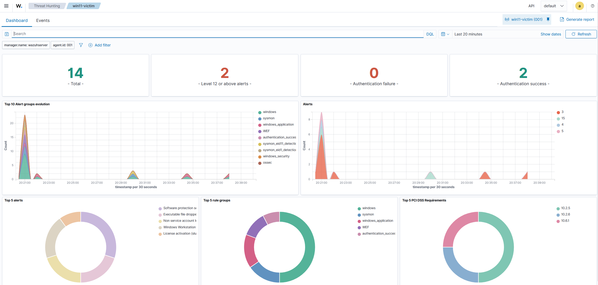
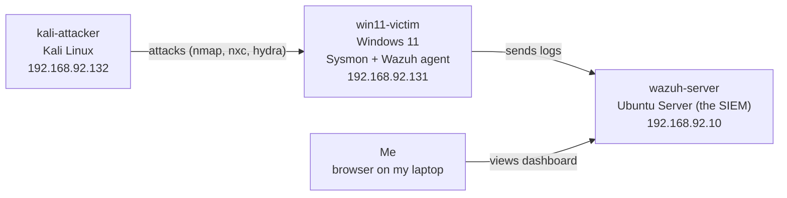
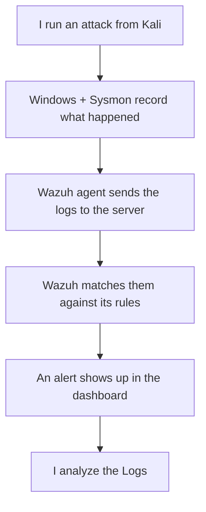
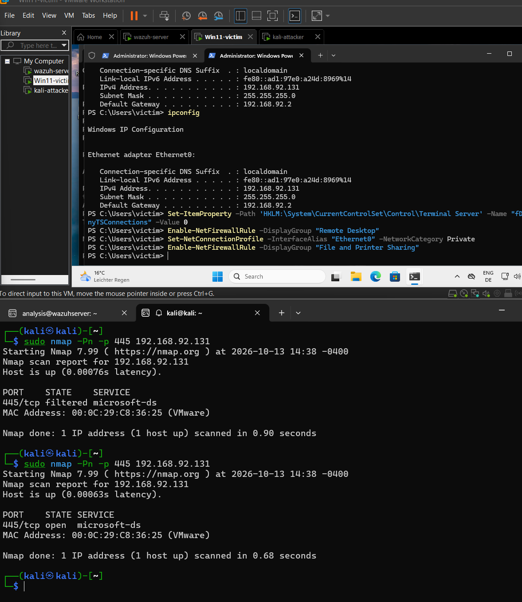
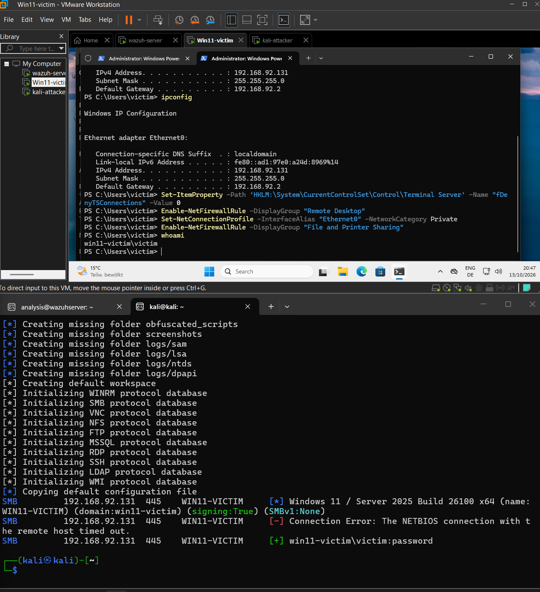
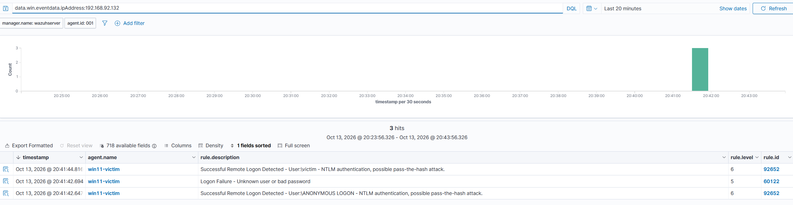
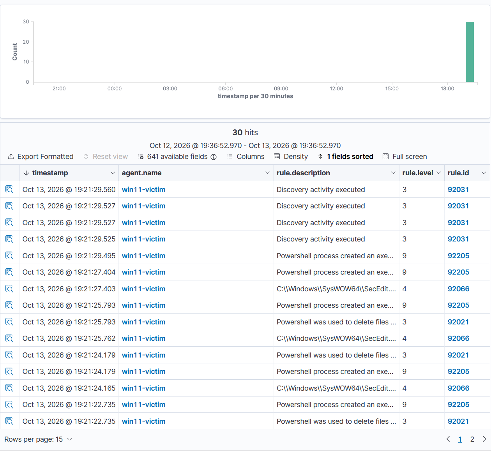

test

# SIEM Home Lab (Wazuh + Sysmon + Kali)

Hi! I'm a Media Informatics student who wants to go into cybersecurity, and I
built this home lab to learn how a SIEM actually works, and I've wanted to try
out VMs for a while. This repo is my write-up of what I did and what I learned.

The basic idea: set up a few virtual machines, attack one of them, and then try
to find the attack in the logs.

## What's in the lab

Three virtual machines on my laptop, all on the same isolated network:

- **wazuh-server** (Ubuntu Server) — the SIEM. This is where all the logs end up
  and where I look for attacks.
- **win11-victim** (Windows 11) — the machine being monitored. It runs the Wazuh
  agent and Sysmon, which send detailed logs to the server.
- **kali-attacker** (Kali Linux) — the attacker. I use this to scan and attack
  the Windows machine.

Here's how it fits together:

I view the Wazuh dashboard from a browser on my normal laptop.

And here's the loop the whole lab is built around — attack on one side, detection
on the other:

## How I set it up (short version)

- **Wazuh server:** installed Ubuntu Server, then ran Wazuh's install script. I
  gave it a fixed IP so the agent always knows where to find it.
- **Windows machine:** installed the Wazuh agent and Sysmon (with the popular
  SwiftOnSecurity config), then told the agent to forward Sysmon's logs. I tested
  it by typing my password wrong a few times — the failed logins showed up in the
  dashboard, so I knew it worked.
- **Kali:** used the ready-made Kali image, and the tools `nmap`, `netexec` and
  `hydra`.

## The attacks I tried

### 1. Scanning the Windows machine
I scanned it with nmap, but every port came back "filtered" — the Windows
firewall blocks everything by default. Interestingly, **nothing showed up in
Wazuh** for the scan. I looked into why, and it's because a scan like that never
really touches anything that gets logged on the computer itself. So a scan can be
basically invisible if you're only watching the computer and not the network.
Good thing to know.

### 2. Opening up SMB
To have something to actually attack, I turned on SMB (file sharing) on the
Windows machine. You can see the firewall change worked — port 445 went from
"filtered" to "open":

### 3. Guessing the password (and it worked)
I used a small list of common passwords and tried to log in over SMB. One of them
worked, because I'd set a weak password (`password`) on purpose:

That green `[+]` line means it got in. It was kind of cool (and a little scary)
how fast a weak password falls.

### 4. Finding the whole attack in Wazuh
This was the most satisfying part in my opinion. I searched Wazuh for everything coming from the
attacker's IP address, and it showed the whole story in one place, the failed
guess, then the successful login, which Wazuh even flagged as a possible
"pass-the-hash" attack:

### 5. Suspicious PowerShell
I also ran an encoded PowerShell command from the attacker shell and
Wazuh picked it up through Sysmon:

One of the alerts had the scariest severity (level 15), but when I opened it up
it was actually harmless, a temporary file Windows makes when PowerShell
starts. So I learned not to panic at a high severity number and to actually check
what the alert is about.

## What I learned

- How logs flow from a computer, through an agent, into a SIEM, and become searchable alerts.
- A SIEM doesn't just store logs, Wazuh actually spotted the suspicious login on
  its own.
- 'password' is not a good password and any script kiddy can crack it
- You can follow an attacker by their IP address to see everything they did.
- A scary-looking alert isn't always a real problem — you have to check.
- Watching only the computer (and not the network) leaves blind spots.

## Stuff that went wrong

......a lot went wrong, and figuring it out was most of the learning. A few
examples: I picked the wrong Ubuntu version at first, I couldn't make a local
Windows account the normal way, `hydra` didn't work against modern Windows so I
switched to `netexec`, and my brute force didn't log anything until I realised
the firewall was blocking the port. 

---

